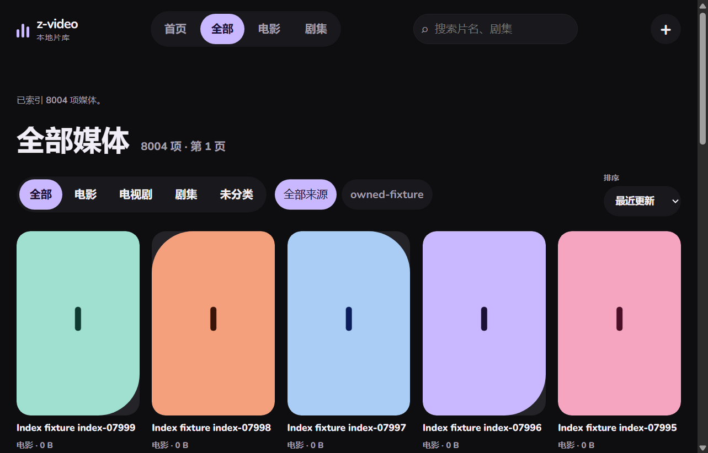
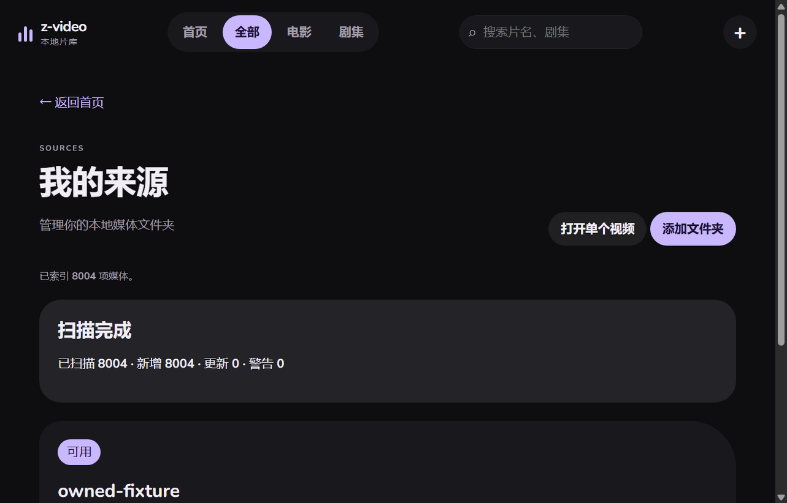
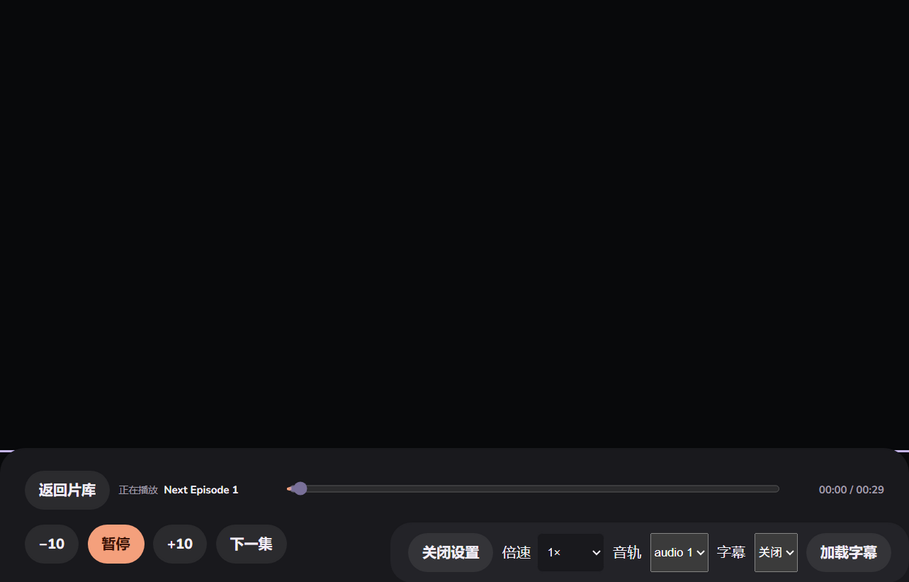
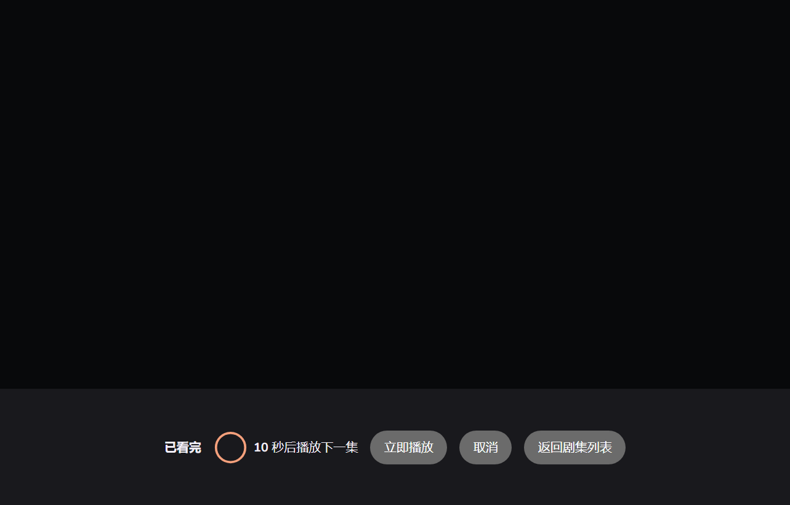

# z-video 本地片库 · 普通用户走查

日期：2026-11-08  
范围：当前 Electron 本地片库（`src/renderer/`、`src/main/`）与 `docs/design/soft-cinema/evidence/windows-fixture` 的 Windows 隔离样本截图。  
方法：假设用户完全不懂“来源、索引、NFO、媒体条目”，只知道“我有一堆电影和剧放在文件夹里，我想在电脑上看”。按第一次打开 → 添加文件夹 → 找片 → 详情 → 播放 → 下一集 → 管理来源的顺序走一遍。  
边界：没有真实播放视频、没有真实 DWM/硬解、没有 macOS 验收；截图来自 2026-11-07 fixture，可能和当前分支有细微差异。代码能证明的标 `C`，截图能证明的标 `S`，需要实机确认的标 `V`。

## 结论

**电影在“文件夹不大、片名能认出来、用户碰巧发现右上角 + 号”的前提下勉强能看；剧集、大库、首次启动和错误恢复这四条主流程走不通。整体不是“再打磨一下”的程度，而是 Critical issues（阻断级）。**

一句话概括：**产品要求用户先理解自己的数据模型（来源 / 索引 / 单集 / NFO），但界面没有教，也没有在关键节点给出下一步。** 目前更像“给开发者自己用的本地片库前端”，还不是“不用说明书就能用”的产品。

## 一、按普通用户走一遍：哪里会停下来

1. **第一次打开**：欢迎卡“你的私人影院，从这里开始”很清楚，两个按钮也看得懂。这一步是好的。
2. **点“添加文件夹”**：系统选择框选完，没有确认页，也没有“将扫描什么、只读、不会移动文件”的说明。第一次刷新后欢迎卡就被隐藏，首页只剩一行“正在扫描本地来源…”。
3. **扫描中**：默认窗口是 1040×720，顶部扫描状态胶囊被 CSS 隐藏；首页没有取消按钮；真正的扫描面板在“来源”页里，但用户不知道要去那里。大文件夹看起来像卡死。
4. **扫描结束**：片库突然出现 8004 项。没有“新增了多少”的确认，因为“扫描完成：新增…”的提示马上被“已索引 8004 项媒体”覆盖。
5. **点“剧集”**：满屏都是单集卡片，卡片上只有单集标题，没有剧名；顶部“剧集”和筛选里的“电视剧 / 剧集”含义重叠。用户找不到“哪部剧”，只能靠搜索碰运气。
6. **点一张卡进详情**：长片名被截断成“Owned UX Audit Feature …”；简介空的时候提示“添加 NFO 文件”，普通用户不知道 NFO 是什么；选集在首屏下方，需要往下滚。
7. **播放**：播放器本身能暂停、拖进度、调音量、开设置。但关掉播放器后回到片库/首页，不是回到刚才的详情；想看下一集得重新找剧。
8. **想删来源**：确认框只说“不删除源文件”，实际会把这个来源下的观看进度一起删掉；确认按钮还是主色紫，像“推荐操作”。
9. **出错**：只有“重试”和“错误代码：storage”；如果首页是空的，页面上没有“添加文件夹”按钮，只剩右上角一个没有文字的 +。

## 二、卡点清单

### P0 · 阻断（主流程走不通或会造成错误理解）

| # | 卡点 | 用户实际经历 | 为什么会卡 | 依据 |
|---|---|---|---|---|
| P0-1 | 剧集没有“剧”的层级 | 点“剧集”看到成百上千张单集卡，卡片通常只有单集标题/文件名，没有剧名；同一个剧的每一集都占一张卡 | 列表按 `media_files` 逐文件返回，`filter:"show"` 只过滤 collection 类型，没有按 collection 聚合；卡片标题用 `displayTitle`，不保证带剧名 | C `local-library-worker.ts:906`、`local-library-worker.ts:514`、`all.ts:25`、`renderer.ts:681` |
| P0-2 | “电视剧”和“剧集”两个筛选项几乎一样 | 点“电视剧”和点“剧集”看到同一批单集；顶部“剧集”又是第三层含义 | `show` 按 `collections.kind` 过滤，`episode` 按 `media_files.media_kind` 过滤；在常见剧集目录里两者返回同一批行 | C `local-library-worker.ts:905-907`、`index.html:74-75`、`index.html:19` |
| P0-3 | 首次扫描是黑箱 | 选完文件夹，第一次刷新后欢迎卡消失，首页空白；只有一行计数，无法取消；默认窗口下连扫描状态胶囊都看不到 | 扫描面板在隐藏的“来源”页；取消按钮在 `.library-toolbar`，首页时父级 `display:none`；`.scan-status` 在 `max-width:1100px` 下隐藏，而默认窗口宽 1040 | C `index.html:47`、`styles.css:217`、`styles.css:224-225`、`renderer.ts:1174`、`window.ts:62` |
| P0-4 | “打开单个视频”并不会播放 | 用户以为选完就开始看，结果只是把视频加进片库，人还停在首页 | 处理函数只调用 `openVideo()` 入库，没有打开详情或播放器；同时把视频所在父文件夹注册成“来源” | C `renderer.ts:1218`、`renderer.ts:1054-1078`、`local-library-ipc.ts:44`、`local-library-worker.ts:1330` |
| P0-5 | 关闭播放器一定退出详情 | 从详情点播放，看完关掉播放器，回到片库/首页；刚才那部剧的选集、简介、来源状态都没了 | `closed` 事件默认走 `closeDetail()`；只有点“返回剧集列表”才保留详情 | C `renderer.ts:456-471`、`renderer.ts:1015-1039`、`renderer.ts:1296` |
| P0-6 | 空状态是死路 | 第一次点“全部”再点“首页”，欢迎卡不再出现；首页只剩一句“还没有本地来源”，没有添加按钮。“全部”空态也只说“选择一个文件夹”，没有按钮 | `navigateHomeOrLibrary("home")` 只隐藏欢迎卡，不会重新显示；`renderPage` 是唯一重新显示的地方，但回首页不会重新调用它；“全部”空态里的搜索/重试按钮在无查询时也是 hidden，实际没有 CTA | C `renderer.ts:1172`、`renderer.ts:576`、`index.html:93-98` |
| P0-7 | 删除来源会静默删观看进度 | 确认框说“只移除应用索引？不删除源文件”，用户以为只是移出片库；实际该来源下的“继续观看”进度也没了 | `removeSource` 先删 `playback_state`，再删媒体和来源；确认文案没有提进度；确认按钮是 `primary-button` | C `local-library-worker.ts:1031`、`renderer.ts:1246`、`index.html:37` |
| P0-8 | 8004 项只能 24 个一页翻 334 页 | “全部媒体”显示 8004 项，每页 24 个，只有上一页/下一页和附近 5 个页码；没有跳到某页、没有首尾页 | `PAGE_SIZE = 24`；`renderPagination` 只生成 `page ± 2`，没有 first/last/jump；顶栏和筛选不吸顶 | C `renderer.ts:37`、`renderer.ts:620-639`、`styles.css:24` |

### P1 · 高摩擦（能走，但会反复卡、走错或失去上下文）

| # | 卡点 | 用户实际经历 | 为什么会卡 | 依据 |
|---|---|---|---|---|
| P1-1 | 换页/换筛选/进详情不回到顶部 | 在第 5 页底部点“下一页”，看到的是第 6 页的最后几行；在首页往下滚后点卡片，详情从中间开始 | 当前 `renderer.ts` 没有 `scrollTo`/`scrollTop` 复位；滚动的是 `body`，不是某个固定高度的内容区 | C `renderer.ts` 全文无复位；`styles.css:35/107` |
| P1-2 | 详情页长片名被截断 | 标题显示成“Owned UX Audit Feature …”，没有 tooltip，也没有第二行 | `.media-detail h2` 设了 `white-space:nowrap`、`overflow:hidden`、`text-overflow:ellipsis`；后面的 `.detail-copy h2` 没有覆盖这三项 | C `styles.css:41`、`styles.css:56`；S `movie-detail.png` |
| P1-3 | 详情加载/失败会显示旧内容，播放按钮仍可点 | 读取慢、扫描中或条目已被移除时，页面还留着上一部片的封面/标题；点“播放”可能播错或失败 | `openDetail` 只把 `detail.hidden=false`，没有本页 loading 骨架；`get` 失败只写全局消息，不重置详情 DOM | C `renderer.ts:867-899` |
| P1-4 | 离线时文案和按钮互相矛盾 | 详情写“已保存进度 00:05 · 可继续或从头开始”，但两个按钮都是灰的；首页 hero 和“继续观看”卡片没有“来源离线”标识 | 离线时只禁用按钮，进度文案没有分支；hero/continue 卡片不检查 `available` | C `renderer.ts:954-978`、`renderer.ts:641-674`、`home.ts:5-37`；S `movie-offline.png` |
| P1-5 | 详情页搜索框是“死”的，还会悄悄改片库 | 详情页顶部搜索框仍可输入；输入后当前页没反应，但关掉详情回片库时列表已经被这个关键词过滤 | `loadLibrary` 在详情可见时直接 return；`input` 事件仍然写入 `currentQuery` | C `renderer.ts:795-799`、`renderer.ts:1366-1375` |
| P1-6 | 首页搜索后清空，回不到首页 | 在首页搜了一下，自动跳到“全部”；点 × 清空，仍停在“全部”，不会回首页 | `searchClear` 只清 query 和重载，不调用 `navigateHomeOrLibrary("home")` | C `renderer.ts:1377-1382` |
| P1-7 | 切“电影/剧集”时搜索词还留着 | 搜过“Owned”后点“电影”，看到的是“Owned”的电影结果，不是全部电影；页面标题仍写“全部媒体” | `navigateHomeOrLibrary` 非 home 分支只改 filter/source，不清 query；页面标题固定“全部媒体” | C `renderer.ts:1179`、`index.html:69` |
| P1-8 | 右上角“+”菜单不说明、不关闭、还夹带“管理” | 用户看到只有一个 +；点开后有“添加文件夹 / 扫描目录 / 打开视频 / 管理来源”，其中“扫描目录”和“添加文件夹”看起来一样；点完任一项菜单还浮在页面上 | `
+
` 没有可见文字；`details` 没有外部点击/Esc 关闭逻辑；两个入口都走文件夹选择器 | C `index.html:22-27`、`renderer.ts:1217-1219`；S `home.png` |
| P1-9 | “来源”页没有导航位置，返回也丢来路 | 从离线详情点“查看来源”，来源页顶部高亮的却是“全部”；点“返回首页”回首页，不是回刚才的详情 | `showSources()` 先调用 `navigateHomeOrLibrary("all")`，没有 sources 的 nav 项；“返回首页”固定 home | C `renderer.ts:1183-1185`、`index.html:19/32`；S `sources.png` |
| P1-10 | 扫描时整个网格反复闪骨架 | 扫描进行中，列表每 350ms 被 8 个骨架替换一次，再重新出现；用户刚看到的条目会跳走 | `scheduleScanRefresh` 反复调用 `loadLibrary`，而 `loadLibrary` 每次先 `replaceChildren` 骨架 | C `renderer.ts:766-793`、`renderer.ts:802-810` |
| P1-11 | 扫描/导入的成功提示马上被覆盖 | 扫完只看到“已索引 8004 项媒体”，看不到“新增 8004、更新 0”的结果；导入单个视频也看不到“已导入《…》” | `renderScanResult`/`handleImport` 先写消息，随后 `loadLibrary()` 又写“已索引 N 项媒体” | C `renderer.ts:1157-1165`、`renderer.ts:1054-1078`、`renderer.ts:821-825` |
| P1-12 | 继续观看计数 50，实际只画 12 张；没有左右按钮 | 片架上写“30 项”，横向只能看到 12 张，滑到头也没有更多；鼠标用户不知道可以横滚 | `listContinueWatching` 最多 50 条；`renderContinueCards` 只取前 12；没有上一屏/下一屏按钮 | C `local-library-worker.ts:1003`、`home.ts:6`、`renderer.ts:708` |
| P1-13 | “最近添加 / 剧集”被单集灌满 | 新加一季 12 集，“最近添加”12 张全是这季的单集；点“剧集”也全是单集，电影被挤走 | 两个片架都用逐文件 `list`，没有按 collection 聚合；`recent` 限 12 | C `renderer.ts:679-682`、`renderer.ts:676-694` |
| P1-14 | 播放结束条像“灰色禁用按钮”，还不知道下一集是什么 | 播完出现“已看完 / 10 秒后播放下一集 / 立即播放 / 取消 / 返回剧集列表”，按钮是系统灰色；没有下一集标题；电影也写“返回剧集列表” | `.player-ended button` 只设了尺寸/圆角，没有背景和文字色，落回 UA 默认按钮；倒计时文案不含标题；`player-return-list` 对所有类型都显示 | C `styles.css:309-311`、`renderer.ts:439-454`、`index.html:172`；S `next-episode.png` |
| P1-15 | 播放设置弹层挤成一行，且不能被 Esc/点外关闭 | “关闭设置 / 倍速 / 音轨 / 字幕 / 加载字幕”挤在一条；音轨和字幕是未样式化的原生下拉；只能找到“关闭设置”或再点“设置” | 弹层没有标题/分组；没有 outside-click 和 Escape 分支；`#player-audio-track/#player-subtitle-track` 没有 CSS | C `index.html:162-170`、`renderer.ts:1312-1317`、`styles.css:162`；S `player-menu.png` |
| P1-16 | 扫描完成面板永久占据来源页顶部 | 扫完 8004 项后，“扫描完成 / 已扫描 8004…”一直占着首屏，来源卡被推到下面；没有关闭按钮 | `renderScanProgress` 只把 `scanPanel.hidden=false`，完成后不隐藏；没有关闭操作 | C `renderer.ts:1126-1155`、`index.html:34`；S `sources.png` |
| P1-17 | 同名来源无法区分，也没有“全部重扫/刷新” | 两个文件夹都叫 `Movies`，来源卡只显示 `Movies`，没有路径或盘符；外部新增文件不会自动出现，只能逐个“重新扫描” | 来源只暴露 `label`（basename），DTO 不含路径；没有全局刷新/rescan all | C `local-library-contracts.ts:27-32`、`sources.ts:4-15` |
| P1-18 | 扫描没有进度条/耗时，只有计数 | 大文件夹扫描时只有“已扫描 372 · 新增 372…”，不知道还要多久，也没有动画/进度 | 扫描面板只有文本计数；`--remaining` 只用于播放结束环，不用于扫描 | C `renderer.ts:1134`；S `scan.png` |

### P2 · 中（不影响走通，但明显增加理解成本）

| # | 卡点 | 说明 | 依据 |
|---|---|---|---|
| P2-1 | 术语体系是开发者语言 | “索引、来源、媒体条目、项、NFO、S01E01、未分类、错误代码 storage”反复出现；用户不知道“索引”是扫描，“来源”是文件夹，“NFO”是元数据文件 | C `index.html:33/35/59`、`renderer.ts:822/973-976`、`renderer.ts:560` |
| P2-2 | “最近更新”和“最近添加”无法区分 | 一个按文件更新时间，一个按入库时间；界面没有解释，普通用户会认为两者同义 | C `renderer.ts:1384-1389`、`local-library-worker.ts:921-923` |
| P2-3 | “返回片库”有时回首页 | 从首页 hero 进详情，按钮写“返回片库”，实际回首页；顶部“全部”/“首页”高亮也不是详情层级 | C `renderer.ts:1015-1039`、`renderer.ts:1167-1180` |
| P2-4 | “已看完”只对当前集有效 | 选集列表只有当前选中集能拿到 `playback`，其他集永远没有已看标记；用户换个集，上一集的勾就没了 | C `renderer.ts:979-987`、`detail.ts:5-14` |
| P2-5 | 1 秒也算“继续观看” | 误点开一个视频 1 秒就进“继续观看”和首页 hero，真正想看的片子会被挤掉 | C `local-library-worker.ts:1001` |
| P2-6 | 卡片 meta 放文件大小，排序对中文不友好 | “电影 · 2026 · ★ 8.7 · 4.2 GB”里文件大小对选片价值低；“标题”排序用 SQLite `NOCASE`，中文不是拼音顺序 | C `all.ts:29-32`、`local-library-worker.ts:915-916` |
| P2-7 | 搜索放大镜不可点 | 放大镜是一个 `span`，不是按钮；用户点它没有反应。虽然输入后会自动搜，但视觉上像一个可点控件 | C `index.html:21` |
| P2-8 | 空简介提示不可行动 | “为影片添加 NFO 文件和海报后，重新扫描来源即可补全信息”没有告诉用户 NFO 放哪、叫什么、怎么命名 | C `index.html:125`、`renderer.ts:954` |
| P2-9 | 没有可见的应用菜单/帮助 | 自绘标题栏只有最小化/最大化/关闭；没有“文件/帮助/关于”，也没有“打开文件夹/设置”的菜单入口。常规桌面用户找不到统一入口 | C `window.ts:66/77`、`index.html:12` |
| P2-10 | 没有单实例 | 双击两次会开两个窗口，两个进程操作同一个 SQLite；扫描时更容易撞锁 | C 全局无 `requestSingleInstanceLock` |
| P2-11 | 播放进度条没有 hover 时间/缓冲 | 只能盲拖；没有“拖到这里是几分几秒”的提示；键盘 ±5 秒和按钮 ±10 秒不一致 | C `index.html:148/152-154`、`renderer.ts:375-382` |
| P2-12 | 播放结束倒计时不显示下一集标题 | “10 秒后播放下一集”不知道是哪一集；对剧集用户无法判断要不要取消 | C `renderer.ts:445` |

### P3 · 低（polish / 边界）

| # | 卡点 | 说明 |
|---|---|---|
| P3-1 | 英文 eyebrow 混排 | 可见的 `WELCOME / SOURCES` 与中文标题混用，像设计稿残留；`LOCAL LIBRARY` 还被 `.content-heading{display:none}` 藏掉了 |
| P3-2 | `−10`/`+10` 是文字不是图标 | 和自绘的 SVG 返回/播放图标不是一个语言；字号和基线也随字体变化 |
| P3-3 | 窗口按钮字形依赖字体 | `− □ × ❐` 是字符，不是图标；`❐` 在部分字体下可能变成方框 |
| P3-4 | `aria-selected` 用在 `<button>` 上 | 选集行不是 `option`/`tab`/`gridcell`，部分读屏会忽略；视觉上另有 `.current` |
| P3-5 | 搜索框原生清除按钮未显式关闭 | `type=search` 仍可能带 Chromium 自带 ×，和自绘清除按钮重复；需要实机确认（V） |
| P3-6 | 原生 tooltip | 视频区域/进度条用 `title` 提示快捷键，鼠标悬停才出现系统提示，和产品视觉不一致 |

## 三、原生控件与未统一控件

这一节只列“在界面里能看见、但明显不是这套设计语言”的控件。系统文件/文件夹选择框是平台原生，**本身不算缺陷**；问题是入口文案没有解释会发生什么。

| 控件 | 位置 | 现在是什么样 | 为什么显眼 | 建议 |
|---|---|---|---|---|
| 音量滑杆 | 播放器 | 只有 `accent-color: var(--lavender)`，轨道和圆形 thumb 都是 Chromium 原生 | 旁边的播放进度是自绘细线 + 长条 thumb，两个滑杆像两个产品 | 用与 seek 同一套自绘轨道/thumb，或至少统一 thumb 形状与高度 |
| 音轨下拉 | 播放器设置 | `select` 没有 class/CSS，字体也不继承（`button,input` 有 `font:inherit`，`select` 没有） | 系统灰边、方形、默认箭头，夹在圆角胶囊中间；截图里“audio 1”几乎贴边 | 统一 trigger 样式 + 自绘箭头；原生弹层可保留，或改自定义 listbox |
| 字幕下拉 | 播放器设置 | 同上 | 同上；字幕“关闭”被挤成两字 | 同上 |
| 倍速/排序下拉 | 播放器设置 / 全部媒体 | 外框做了胶囊/深色，但箭头和展开列表仍是系统原生 | 静态看是“半设计”，点开是另一个世界 | trigger 可以保原生，但补自绘 chevron；或统一自定义 |
| 播放结束按钮 | 播放器结束条 | 只有 `min-height/padding/border-radius`，没有 background/color | 落回 Windows 灰色按钮，看起来像禁用；和上面橙色暂停键完全脱节 | 明确 primary/secondary/destructive 三种样式 |
| 滚动条 | 主内容区、横向片架、简介 | 没有 `scrollbar-color` / `::-webkit-scrollbar` | Windows 截图里是浅色经典滚动条带上下箭头，深色影院底上非常跳 | 深色细滚动条；横向片架加左右按钮，不要只靠滚动条 |
| 搜索框清除 | 顶部搜索 | 自绘 44px `×`，但 `type=search` 的原生 cancel 未禁用 | 可能出现两个 ×；即使不重复，原生按钮的尺寸/位置也不可控 | 显式隐藏 `::-webkit-search-cancel-button`，只保留一个自绘按钮 |
| 文件/文件夹选择 | 添加来源/字幕 | Electron `dialog.showOpenDialog`，系统原生 | 这是正确的平台行为 | 保留；但在打开前用一句话说明“只读索引/不会移动文件/支持哪些格式” |
| 文字图标 | 标题栏、播放器、搜索 | `− □ × ❐ / −10 / +10 / + / ⌕` | 不是图标库，受字体影响，粗细/基线不一致 | 换成 SVG 图标；保留 `aria-label` |
| 原生 tooltip | 播放器 | `title` 属性 | 系统黄/白提示，和深色 UI 不搭；而且用户不 hover 就看不到 | 关键快捷键做成可展开的“快捷键”帮助，不依赖 tooltip |
| 对话框 | 移除来源 | 自绘 `dialog` + `::backdrop` | 这个是统一的，不是问题 | 保留，但把确认按钮改成 destructive 样式 |

## 四、文案与术语：把开发者词汇翻译成用户词汇

| 现在 | 用户会怎么理解 | 建议 |
|---|---|---|
| 索引 / 已索引 | 不知道是扫描、建库还是上传 | “正在扫描这个文件夹”“已加入片库” |
| 来源 | 可能是网盘、NAS、账号 | “文件夹”或“片库文件夹” |
| 扫描目录 | 和“添加文件夹”一样，不知道为什么有两个 | 合并成一个；需要重扫时叫“重新扫描这个文件夹” |
| 打开单个视频 | 以为马上播放 | “添加单个视频”或选完直接进详情/播放 |
| NFO 文件 | 完全不知道是什么 | “影片信息文件（NFO）”；并给出放哪里、怎么命名的例子 |
| S01E01 | 只有剧迷懂 | “第 1 季 第 1 集” |
| 未分类 | 不知道是被跳过了还是没识别 | “其他视频”/“未识别” |
| 最近更新 / 最近添加 | 两者同义 | “最近修改的文件”/“最近加入片库” |
| 已保存进度 / 已保存至 | 像云同步 | “看到 00:05”/“上次看到 00:05” |
| 媒体条目 / 项 | 像数据库 | “部影片”“集” |
| 错误代码：storage | 不知道能做什么 | “片库文件无法读写”；给“打开数据文件夹/重启/查看日志”之一 |
| 电视剧 / 剧集 | 两个词指同一件事，又指不同层级 | 统一：顶部“剧集”= 按剧聚合；筛选“单集”= 单集列表 |
| WELCOME / SOURCES | 装饰性英文，增加噪音 | 中文或去掉 |
| 可继续或从头开始（离线时） | 和禁用按钮矛盾 | 离线时改成“来源离线，重新连接后可继续” |

## 五、可访问性与桌面惯例

- **焦点不跟随视图切换**：打开详情时没有把焦点移到详情标题/返回按钮；读屏和键盘用户还停在已经隐藏的卡片上。`openDetail` 没有 `.focus()`（C `renderer.ts:867-899`）。
- **列表 live region 太吵**：`#library-grid` 有 `aria-live="polite"`，每次翻页/筛选会用 24 张卡片整体替换，读屏可能一次念完一整页（C `index.html:92`、`renderer.ts:580`）。
- **高对比度设置没有进入 UI**：main 进程检测 `shouldUseHighContrastColors` 并通过 IPC 发送，但 renderer 没有监听 `window.zVideo.appearance.onState`，也没有 `forced-colors` 样式；检测目前只影响窗口材质（C `window.ts:11-23/40-57`、全局搜索无 `appearance` 使用）。
- **没有可见的菜单/帮助/缩放入口**：`frame:false` + `setMenuBarVisibility(false)`，所有命令散落在页面按钮里；标准桌面用户找不到“文件/帮助/关于”，也没有统一的打开文件夹入口（C `window.ts:66/77`）。
- **最小宽度 900**：窗口最小 900×640，正文没有低于 900 的布局；如果用户需要放大界面，没有可见的缩放/文字大小入口（C `window.ts:64-65`、`styles.css:18`）。
- **扫描/倒计时状态没有被可靠播报**：默认宽度下 `.scan-status` 被 `display:none`；播放结束倒计时只有视觉文本，`player-status` 只播报“播放结束”（C `styles.css:217`、`renderer.ts:439-454`）。
- **做得好的部分**：全局 `:focus-visible` 3px 紫色描边、`prefers-reduced-motion` 关闭动效、移除对话框默认聚焦“取消”、播放器快捷键、`aria-label` 覆盖图标按钮；这些应保留。

**另外值得保留的**：生成封面保证无海报时卡片不空白；离线详情会禁用播放并给出横幅（虽然文案要改）；移除确认已经替换掉 `window.confirm`；播放器有音轨/字幕/倍速/外挂字幕；来源卡有可用/扫描中/离线状态。这些不是问题，修的时候不要一起推翻。

## 六、优先修复顺序（先不改代码，按用户影响排序）

1. **先修“剧”的层级**：顶部“剧集”按 collection 聚合成一张剧卡；卡片显示剧名 + 季/集数；筛选改成“剧集 / 单集”并解释。没有这一步，剧集用户永远在单集海里捞。
2. **首次扫描可见、可取消、可恢复**：欢迎卡保留到第一条内容出现；首页显示进度/取消；默认宽度下保留扫描胶囊；不要把“扫描完成”提示立刻覆盖。
3. **把“打开单个视频”改成真打开**：选完直接进详情/播放；如果只是入库，改名为“添加单个视频”，并说明会把所在文件夹注册为来源。
4. **播放器关闭回到详情**：保留 `activeDetail`；只有用户点“返回片库”才退出详情；返回时恢复滚动位置。
5. **空态/错误态给下一步**：首页空、全部空、首次欢迎卡回来都要有“添加文件夹”；storage 错误给“打开数据文件夹/重启/查看日志”，不要只给一个代码。
6. **删除来源说清楚**：确认框明确“会删除观看进度，不删除源文件”；确认按钮改 destructive，最好支持撤销或至少不可轻易误点。
7. **大库可导航**：分页加首页/末页/跳页，或改成虚拟滚动；顶栏/筛选吸顶；翻页、筛选、进详情都回到顶部。
8. **统一原生控件**：音量、音轨/字幕、播放结束按钮、滚动条、搜索清除；先做前三个，视觉收益最大。
9. **术语清理**：索引/来源/NFO/S01E01/未分类/媒体条目/最近更新；一轮文案替换就能显著降低“说明书感”。
10. **补无障碍**：列表不要整体 live region；详情打开移焦点；高对比度接入；扫描/倒计时可播报。

## 七、附：证据与边界

- 代码依据：[renderer.ts](../../src/renderer/renderer.ts)、[index.html](../../src/renderer/index.html)、[styles.css](../../src/renderer/styles.css)、[local-library-worker.ts](../../src/main/local-library-worker.ts)、[local-library-ipc.ts](../../src/main/local-library-ipc.ts)、[window.ts](../../src/main/window.ts)。
- 截图依据：`docs/design/soft-cinema/evidence/windows-fixture/` 下的 `onboarding.png`、`home.png`、`all.png`、`sources.png`、`scan.png`、`movie-detail.png`、`movie-offline.png`、`episode-detail.png`、`player.png`、`player-menu.png`、`next-episode.png`、`error.png`。
- 截图来自 `capturePage`，不证明 native 视频画面、DWM 合成、真实硬解；macOS 未验收。真实媒体、共享目录、错误注入仍需单独走查。
- 本次只做走查和清单，没有改代码。

## 八、关键截图

